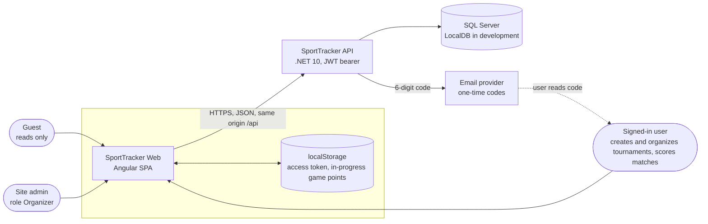
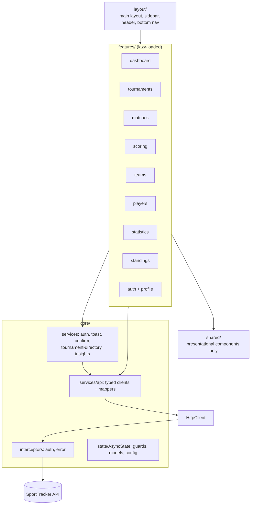
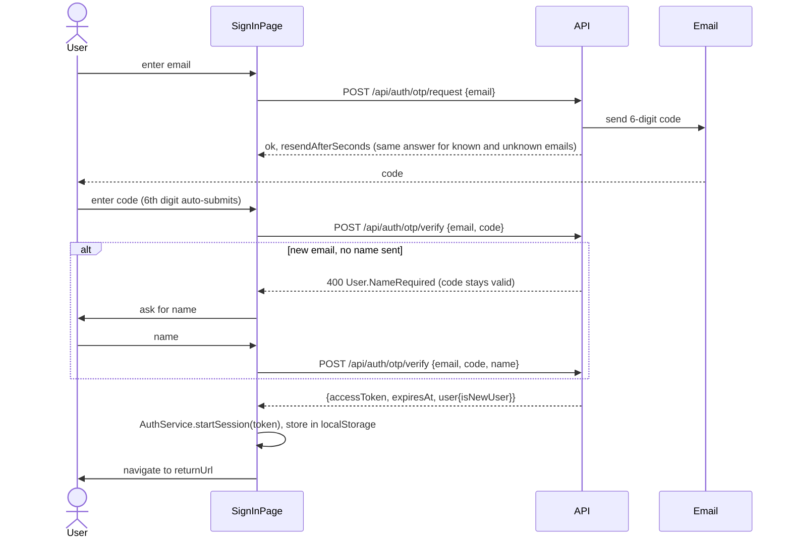
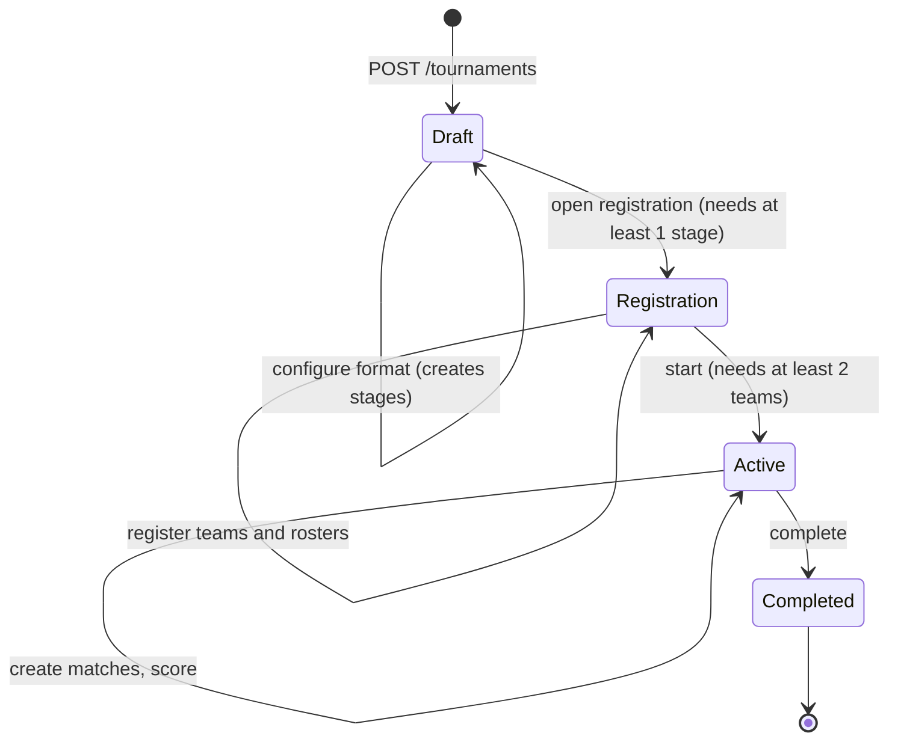
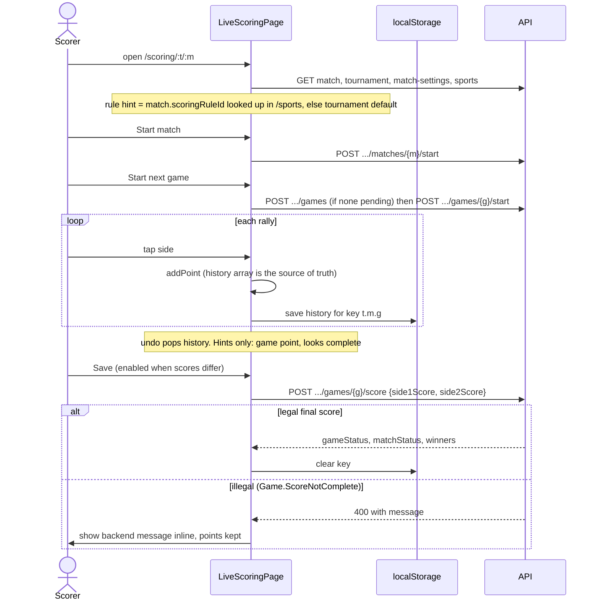
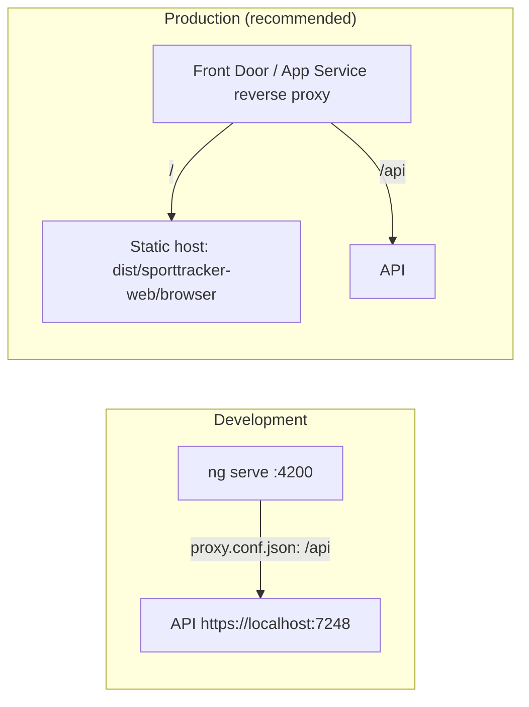

# SportTracker Web: architecture

The architect's view of the frontend: where it sits, how it is built, how data and identity flow, how it is deployed, and what is risky. For the reasoning behind each choice see [design-decisions.md](design-decisions.md); for the API contract and its gaps see [backend-analysis.md](backend-analysis.md).

Diagrams are [Mermaid](https://mermaid.js.org/). They render on GitHub, in Azure DevOps wikis and in VS Code with a Mermaid extension.

Facts here were checked against the code on 2026-11-09 (Angular 21, 164 unit tests passing, initial bundle 316.76 kB raw / 88.87 kB transferred).

## 1. Context

SportTracker is a table tennis tournament platform. This repository is the **browser client only**. The .NET 10 API (repo `SportTracker`, Clean Architecture) owns all data and all business rules.

| Concern | Where it lives |
|---|---|
| Business rules (who may do what, legal scores, lifecycle transitions) | API only |
| Presentation, navigation, what to *offer* the user | This repo |
| Identity (OTP issue and verify, JWT signing) | API |
| Session token storage | Browser `localStorage` |
| Persistent data | API database. The frontend stores nothing durable except the token and unsaved game points. |

## 2. Frontend structure

Dependency rule: `features` may use `core`, `shared` and `layout`; `core` and `shared` never import from `features`. Features do not import each other's pages (they share logic through `core`). Components never inject `HttpClient`; only `core/services/api/*` does.

### Runtime composition (`app.config.ts`)

- `provideRouter(routes, withComponentInputBinding(), paramsInheritanceStrategy 'always', scroll restoration)`
- `provideHttpClient(withInterceptors([authInterceptor, errorInterceptor]))`: request goes through auth first, response errors come back through the error interceptor.
- Custom `TitleStrategy` for page titles.
- No NgModules; components are standalone with `OnPush`. Client-side rendering only (no SSR or prerendering is configured).

### Route map

| Path | Access | Notes |
|---|---|---|
| `/dashboard` | public | default redirect |
| `/tournaments` | public | list; "My tournaments" toggle for signed-in users |
| `/tournaments/new` | signed in | `authGuard` |
| `/tournaments/:tournamentId` | public | shell with tabs: overview, `teams`, `stages`, `matches`, `standings`, `mvp`, `settings` (the settings tab is guarded) |
| `/matches`, `/matches/:tournamentId/:matchId` | public | `/matches/new` is guarded (`authGuard`) |
| `/scoring/:tournamentId/:matchId` | signed in | `authGuard`; the API still requires ownership |
| `/teams`, `/teams/:teamId`, `/players`, `/players/:playerId`, `/statistics` | public | players pool needs sign-in for the full list |
| `/profile` | signed in | |
| `/sign-in` | public | accepts `?returnUrl=` set by the guard |
| `**` | public | not-found page |

"Public" means the UI lets a guest in; the API decides what data it returns.

## 3. Data flow

1. A page creates an `AsyncState<T>` and calls `load(api.something())`.
2. The typed client in `core/services/api` issues the request. `API_BASE_URL` is the only place the base URL is read.
3. The **auth interceptor** adds `Authorization: Bearer ...` only when the URL starts with the API base URL and a non-expired token exists.
4. The response passes through `mappers.ts`: `unwrap()` strips `Result<T>` envelopes, `parseEnum` converts numeric or string enums into string unions, server timestamps (no `Z`) are treated as UTC.
5. On failure the **error interceptor** converts the `HttpErrorResponse` into an `ApiError` (status, backend `code`, detail). A 401 with a stored token signs the user out.
6. The page renders `data`, `loading` or `error` signals. Failed loads show `st-error-state` with Retry; failed actions raise a toast with the backend message.

Cross-page state is deliberately small:

| State | Holder | Scope |
|---|---|---|
| Token, claims, `canManage()` | `AuthService` (signals) | app |
| All tournaments with rosters, "my roles" | `TournamentDirectory` | app; reload with `load(true)` after any change |
| Current tournament and `canManage` | `TournamentContext` | provided by the tournament shell, one per open tournament |
| Per-page data | `AsyncState<T>` | page, cancelled on destroy |
| In-progress game points | `localStorage` key `sporttracker.scoring.{tournament}.{match}.{game}` | device |

Cross-tournament views (dashboard, statistics, player history) have no API support (gap G8), so `InsightsService` fans out one request per tournament or match, all in parallel (`forkJoin`, no batching or concurrency cap), tolerating individual failures (a failed call yields `null`). `TournamentDirectory` does the same for tournament details. This is the main scalability limit (section 8).

## 4. Identity and authorization

### Sign-in (passwordless email code)

API limits that the UI reflects: 6 digits, 5 minutes validity, 5 attempts, 60 s resend cooldown, 5 requests per hour (429 `Otp.TooManyRequests`).

### Authorization model

- Two roles in the token: `User` and `Organizer` (the site admin). `sub` is the numeric user id.
- Anyone signed in may create a tournament and becomes **its** organizer. Writes to a tournament need its organizer or an admin; others get 403 `Tournament.Forbidden`. Guests get 401 `Auth.Required`.
- The client decodes the JWT (no signature check, it cannot) **only to choose what to show**: `AuthService.canManage(organizerUserId)` and `TournamentContext.canManage`. Every action is re-checked by the API. A tampered token only changes the UI; it cannot change data.
- Route guards (`authGuard`) are navigation conveniences, not security.

### Security posture

| Topic | Current state | Residual risk / action |
|---|---|---|
| Token storage | JWT in `localStorage` | Readable by any XSS. Mitigations in place: no `innerHTML`/third-party scripts, Angular template sanitization, token only sent to the API origin. Before production consider a short token lifetime plus refresh in an httpOnly cookie. |
| Transport | HTTPS to the API (`https://localhost:7248` in dev, `secure:false` in the dev proxy for the dev certificate) | Enforce HTTPS and HSTS at the host. |
| CORS | Not needed while same-origin; the API has no policy | A separate-origin deployment requires one (G6). |
| Content-Security-Policy | Not set | Add at the host (script-src self, connect-src API origin). Not yet done. |
| Account enumeration | OTP request returns the same answer for known and unknown emails | n/a |
| Privacy | Public tournament payload no longer carries player emails; only `/profile` shows your own | Verify on the live API. |
| Brute force on codes | API rate limits and attempt caps | Client shows 429 and a cooldown timer; it is not a control. |
| Test-only code | `Auth:Otp:FixedCode` accepted without email, API honours it in Development only | Never set outside Development. |

## 5. Tournament lifecycle and scoring

### Tournament lifecycle (client rules in `tournament-logic.ts`, enforced by the API)

`Cancelled` exists as a status but the client has no action that produces it. Format can be configured only in `Draft` with no stages; teams can be registered only in `Registration`.

### Match and game states

Match: `Scheduled -> InProgress -> Completed`, or `Walkover` / `Cancelled` from the organizer. Game: `NotStarted -> InProgress -> Completed`.

### Live scoring (the hardest flow)

The API accepts one **final** score per game, once. Points are therefore counted in the browser.

Design consequences: the scoring rule in the browser is advisory; the saved score is authoritative. If the scorer's device dies mid-game, the unsaved points exist only in that browser. Server-side point events (G7) would remove this and enable live spectators.

## 6. Deployment and environments

| Item | Detail |
|---|---|
| Build | `npm run build` produces static files in `dist/sporttracker-web/browser/` (no server-side rendering). |
| Config | `src/environments/environment.ts` (production) and `environment.development.ts`, both `apiBaseUrl: '/api'`. Swapped by `fileReplacements` in `angular.json`. Read only in `core/config/api.config.ts`. |
| Same-origin hosting | Recommended. No CORS policy needed; the browser sees one origin. |
| Cross-origin hosting | Set `apiBaseUrl` to the API origin and add a CORS policy to the API first. |
| SPA routing | The host must serve `index.html` for unknown paths (deep links such as `/tournaments/3/matches`). |
| Caching | Hashed JS/CSS filenames: cache long. `index.html`: no-cache. |
| CI/CD | **None exists in this repo.** A pipeline should run `npm ci`, `npm test`, `npm run build`, and (once set up) Playwright. See [CONTRIBUTING.md](../CONTRIBUTING.md). |
| Secrets | None in the frontend. The token is user-specific and issued at runtime. |

## 7. Quality attributes

| Attribute | Approach | Evidence / gap |
|---|---|---|
| Performance | Lazy-loaded features, `OnPush`, signals, no UI framework | Initial bundle 316.76 kB raw / 88.87 kB transferred. No Lighthouse or real-device measurement yet. |
| Scalability | Read fan-out per tournament (G1/G18, G8, G14) | Fine for tens of tournaments; see section 8 for the break point. |
| Reliability | `AsyncState` cancels stale requests; failed loads show Retry; scoring survives reload via `localStorage` | Offline use is not supported. |
| Maintainability | Boundary mappers, pure logic modules, typed API clients, dependency rule (section 2) | The dependency rule is by convention, not lint-enforced. |
| Testability | Pure functions plus `HttpTestingController` contract tests | 22 spec files, 164 tests passing. E2E specs exist but have never been run. |
| Accessibility | Native `<dialog>`, labelled controls, `aria-live`, `role="alert"` on errors, light/dark via `prefers-color-scheme` | No automated a11y audit yet. Keyboard and screen reader paths unverified. |
| Responsiveness | Mobile-first: sidebar on desktop, bottom bar (4 items plus More) on phones, tables degrade to cards | Never reviewed in a real browser at 360 px. |
| Observability | None client-side | No error reporting or analytics. Add before production. |
| Browser support | Evergreen browsers (Angular 21 defaults) | Not separately tested. |
| i18n | English only, no locale framework | Dates use native inputs. |

## 8. Risks and roadmap

| # | Risk | Likelihood / impact | Mitigation |
|---|---|---|---|
| 1 | Never run against the live API; contracts came from source and unit tests | High / High | Do the first manual walkthrough, then run Playwright. This is the top priority. |
| 2 | Per-tournament fan-out (directory, insights) degrades as data grows | Medium / Medium | Ask the backend for a roster-bearing or paged list and cross-tournament endpoints (G8, G18). |
| 3 | Unsaved scoring points are device-local | Medium / Medium | Backend point events (G7). Until then the organizer should Save after each game. |
| 4 | `localStorage` token and no CSP | Low-Medium / High | CSP at the host; consider httpOnly cookie session before production. |
| 5 | No CI, no error telemetry | High / Medium | Add a pipeline and a client error reporter. |
| 6 | API enum and envelope inconsistencies | Certain / Low | Contained in `mappers.ts`. Shrinks if the backend adds `JsonStringEnumConverter` and consistent envelopes. |
| 7 | No tournament edit/delete or rescheduling in API | Certain / Low | Reported (G3). UI honestly omits them. |

Suggested sequence: (1) live run and fix, (2) Playwright, (3) CI pipeline, (4) CSP and error reporting, (5) backend: CORS (only if cross-origin), tournament list with rosters, point events.

## 9. Architecture decisions index

Each is explained, with alternatives, in [design-decisions.md](design-decisions.md).

| ID | Decision | Status |
|---|---|---|
| D2.1 | Dev proxy / relative `/api` instead of CORS | Accepted; revisit for cross-origin hosting |
| D2.2 | One mapping layer at the HTTP edge | Accepted |
| D2.3 | No UI framework, native `<dialog>`, inline SVG icons | Accepted |
| D2.4 | Token-based global SCSS design system | Accepted |
| D2.5 | Signals plus a small `AsyncState` helper, no store | Accepted; revisit if cross-page caching grows |
| D2.6 | Single error interceptor producing `ApiError` | Accepted |
| D2.7 | Passwordless email OTP, JWT in `localStorage`, UI-only permission checks | Accepted; storage to revisit before production |
| D2.8 | Tournament list from API (the id-probing workaround was removed) | Superseded |
| D2.9 | Teams and players from API pools (derivation kept only for per-tournament participation and the guest player list) | Superseded in part |
| D2.10 | Browser-side point counting, API validates the final score | Accepted; superseded when point events exist |
| D2.11 | Lazy routes, params bound to inputs, tabs as child routes | Accepted |
| D2.12 | Sidebar on desktop, bottom bar on phones | Accepted |
| D2.14 | Logic in pure functions, contract tests with real payload shapes | Accepted |

## 10. Glossary

| Term | Meaning |
|---|---|
| Tournament | A competition with a format, teams, stages and matches. Has an organizer (the creating user). |
| Organizer (tournament) | The user who created it; may manage it. |
| Organizer (role) | In the JWT, the **site admin** role. It may manage every tournament. Confusing name, kept for API compatibility. |
| Player | A registered user's playing identity. Every account is a player. |
| Team | A named group of players, registered into tournaments with a roster. |
| Roster | The players a team registers with for one tournament. |
| Stage | A phase of a tournament (round robin, groups, knockout, custom). Created by choosing a format. |
| Sport format | Singles, doubles, and so on, from the `/sports` catalogue. |
| Scoring rule | Games to win, points to win, win-by, maximum points. |
| Match | A fixture between two sides, made of games. |
| Game | One set to a points target. A match is best of `2 * gamesToWin - 1`. |
| Side | One participant slot in a match (side 1, side 2). |
| Walkover | A match awarded without play. |
| MVP | Per-tournament player leaderboard from `/mvp`. |
| OTP | The 6-digit emailed one-time code used to sign in. |
| `Result<T>` | Backend envelope `{isSuccess, isFailure, errors, value}` returned by some endpoints. |
